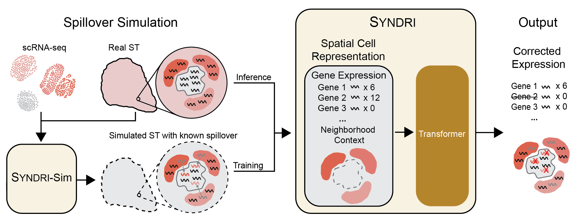

# Syndri


**Syndri** identifies transcript spillover in imaging-based spatial transcriptomics using gene expression, cell identity, and neighboring cell types. This repository provides data preparation, model training, inference, evaluation, and figure generation for *SYNDRI: Context-aware removal of transcript spillover in imaging-based spatial transcriptomics*.

Supported experiments are whole mouse brain MERFISH (**BM**), NSCLC CosMx (**NC**), breast cancer Xenium (**BX**), and the CosMx synthetic-admixture benchmark (**SIM**). All commands below run from the repository root.

This README covers installation, configuration, and commands. See [REPRODUCIBILITY.md](REPRODUCIBILITY.md) for analysis cohorts, numerical definitions, defaults, and interpretation limits.

## Installation

```bash
conda env create -f environment.yml
conda activate syndri-recomb
```

Alternatively, use Python 3.10 with a suitable PyTorch installation:

```bash
python -m pip install -e .
```

Training and inference support NVIDIA GPUs through PyTorch/CUDA. Data preparation, evaluation, and plotting can run on CPU. Outputs are written to `outputs/`.

## Quick start

```bash
# Prepare data and pretrained checkpoints; verify their checksums.
python run.py setup

# Reproduce the supported paper panels using the included predictions.
python run.py reproduce
```

`setup` uses files already present, copies any missing files from a configured local data folder, and downloads remaining files when a release URL is configured. Analysis commands perform the same asset preparation automatically. `reproduce` evaluates the included predictions and renders figures; training and new inference are separate commands.

**Download availability:** the data and four trained checkpoints are included in this distribution. Public archive URLs for these exact processed files are still **FILL IN**. A source-code-only checkout therefore needs either a local asset bundle or a release URL in the parameter file. The original public study portals are listed below.

## Parameter file

[configs/reproduction.yaml](configs/reproduction.yaml) controls asset acquisition and selects experiment parameter files. It is loaded by default. To use your own YAML or JSON file:

```bash
python run.py --params configs/my_run.yaml setup
python run.py --params configs/my_run.yaml reproduce
```

Paths in the parameter file are relative to the repository root. A custom file can contain only the settings you want to override. For example, to copy required assets from `inputs/release/`, preserving its `assets/` and `configs/` subdirectories:

```yaml
assets:
  local_directory: inputs/release
  auto_download: false
  verify: true
```

For automatic downloads, set `assets.base_url` to the HTTPS root of a published asset mirror. The mirror must preserve the relative paths in [assets/manifest.json](assets/manifest.json). You can also set `assets.local_files` or `assets.urls` for individual files:

```yaml
assets:
  local_files:
    assets/models/NC/model-68.pt: inputs/model-68.pt
```

Copied and downloaded files must match the manifest SHA-256 checksums. Missing files without a configured source produce a list of the required assets before any downloads begin. Configuration files remain editable.

Experiment settings are selected in the same parameter file:

```yaml
configuration:
  paper: configs/paper.yaml
  context: configs/context.json
  models:
    NC: configs/models/NC.yaml
```

| Parameter file | Settings |
| --- | --- |
| [configs/paper.yaml](configs/paper.yaml) | Dataset locations, labels, mapping, correction, simulation, evaluation, and marker sets |
| [configs/models/](configs/models/) | Transformer architecture, tokenization, sampler, optimizer, and training settings for each dataset |
| [configs/context.json](configs/context.json) | Xenium sections, query/context sampling, and marker definitions for context perturbation |
| [configs/dataset_sources.json](configs/dataset_sources.json) | Public study accessions and data portals |

## Data

| Dataset | Spatial measurements | scRNA-seq reference |
| --- | --- | --- |
| NSCLC CosMx (NC) | [NSCLC FFPE portal](https://brukerspatialbiology.com/products/cosmx-spatial-molecular-imager/ffpe-dataset/nsclc-ffpe-dataset/) | [GEO GSE127465](https://www.ncbi.nlm.nih.gov/geo/query/acc.cgi?acc=GSE127465) |
| Breast cancer Xenium (BX) | [GEO GSE311609](https://www.ncbi.nlm.nih.gov/geo/query/acc.cgi?acc=GSE311609) | [CELLxGENE breast collection](https://cellxgene.cziscience.com/collections/bd552f76-1f1b-43a3-b9ee-0aace57e90d6) |
| Whole mouse brain MERFISH (BM) | [CELLxGENE whole mouse brain collection](https://cellxgene.cziscience.com/collections/0cca8620-8dee-45d0-aef5-23f032a5cf09); measured, non-imputed counts | [Allen Brain Cell Atlas WMB-10X](https://github.com/AllenInstitute/abc_atlas_access/blob/main/descriptions/WMB-10X.md) |

The reproduction inputs under `assets/data/` contain processed counts, harmonized labels, spatial coordinates, training partitions, simulation ground truth, and Syndri probabilities. Public study portals provide the original studies; the release manifest identifies the exact processed files used for reproduction.

```bash
# List public study sources.
python run.py download --sources

# Audit counts, identifiers, labels, and training/validation separation.
python run.py preprocess --dataset all

# Optionally rebuild Harmony integration and pseudo-spatial mapping.
python run.py preprocess --dataset NC --rebuild
python run.py preprocess --dataset NC --select-representative --rebuild
```

For the simulation experiment, rebuild its training data and generate admixture with:

```bash
python run.py preprocess --dataset SIM --rebuild
python run.py simulate --rebuilt
```

Without `--rebuilt`, simulation uses the included clean test matrix. Generated slices retain `original_counts` and `synthetic_admixture_counts`, whose sum is `.X`. See the [mapping and partition definitions](REPRODUCIBILITY.md#pseudo-spatial-mapping-and-partitions) and [simulation settings](REPRODUCIBILITY.md#simulation-benchmark) for the underlying choices.

## Pretrained models

Copies of the four checkpoints used to generate the results are included under [assets/models/](assets/models/).

| Experiment | Checkpoint | Model configuration |
| --- | --- | --- |
| BM | [model-130.pt](assets/models/BM/model-130.pt) | [BM.yaml](configs/models/BM.yaml) |
| NC | [model-68.pt](assets/models/NC/model-68.pt) | [NC.yaml](configs/models/NC.yaml) |
| BX, including context perturbation | [model-50.pt](assets/models/BX/model-50.pt) | [BX.yaml](configs/models/BX.yaml) |
| SIM | [model-29.pt](assets/models/SIM/model-29.pt) | [SIM.yaml](configs/models/SIM.yaml) |

Checkpoint checksums and sizes are recorded in [assets/models/checkpoints.json](assets/models/checkpoints.json) and the release manifest. Inference uses these checkpoints by default.

## Training

```bash
python run.py train --dataset NC
python run.py train --dataset BM
python run.py train --dataset BX
python run.py train --dataset SIM
```

Use `--epochs 100` to change the epoch limit, `--resume` to continue a run, or `--rebuilt` to use regenerated training data. New checkpoints are saved under `outputs/models/<dataset>/`. Training from scratch can produce different weights because of stochastic optimization.

Data-loader workers default to zero; set `trainer.num_workers` in the model configuration to enable multiprocessing.

## Inference and correction

```bash
# Infer one section or every section in a dataset using pretrained weights.
python run.py infer --dataset NC --slice Lung5_Rep1
python run.py infer --dataset BX

# Use a newly trained model.
python run.py infer --dataset NC --retrained --milestone 68

# Infer on newly generated synthetic test slices.
python run.py infer --dataset SIM --generated-test
```

Outputs under `outputs/predictions/` contain input counts in `.X`, probabilities in `admix_probs`, and corrected counts in `syndri_corrected_counts`, plus threshold diagnostics. Use `--unit cell` for per-cell thresholds. The [correction definitions](REPRODUCIBILITY.md#count-correction-and-cell-selection) describe the default rule and its interpretation.

Edit `correction` in the paper parameter file to change the rule. Batches default to 16; reduce `--batch-size` if needed. `--max-cells` writes development outputs under `outputs/.checks/`.

## Figures and evaluation

```bash
python run.py evaluate --dataset all
python run.py figures --panel figure1
python run.py figures --panel figure2
python run.py figures --panel figure3
python run.py figures --panel figure4
python run.py figures --panel context
```

| Panel group | Outputs |
| --- | --- |
| Figure 1 | T-cell tumor-transcript prevalence and normalized boundary-distance histograms |
| Figure 2 | Reference, Raw, and Syndri UMAPs; scatter-only PNGs and separate legend; evaluation summaries |
| Figure 3 | Before/after MMD², directed cell-type adjacency, marker co-detection, Syndri PR curves, AUPRC/F1, and known/native count removal |
| Figure 4 | Pooled Lung5 marker removal and fibroblast tumor–stroma volcano/Z plots |
| Context perturbation | Fixed-query schematic, burden-stratified responses, 32-gene heatmap, vascular plausibility, and controlled/original-context slopes |

Images are exported as high-resolution PNG, SVG, and PDF under `outputs/panels/`; numerical source tables are under `outputs/tables/`. Figures use a maximum width of 7.5 inches, 8 pt axis/tick labels, and 10–12 pt titles. Use `figures --panel figure2 --skip-metrics` for UMAP-only exports. Full-dataset silhouette evaluation can be computationally expensive.

### Context perturbation

```bash
# Plot the included summaries without new inference.
python run.py context

# Explicitly regenerate contexts, predictions, and statistics.
python run.py context --stage prepare
python run.py context --stage infer --batch-size 16
python run.py context --stage analyze
python run.py context --generated
```

Preparation replays the included query/donor selections. Preparation and inference accept `--slice B1_1`; analysis requires all eight sections. For a fresh run, use `--output outputs/context_new`; add `--resample` consistently to preparation and inference to choose new queries/donors.

[notebooks/ContextResponsiveness.ipynb](notebooks/ContextResponsiveness.ipynb) provides separate cells for each panel. See the [context-analysis definitions](REPRODUCIBILITY.md#context-perturbation-analysis) for cohorts, sampling, statistics, and panel interpretation.

## Outputs

| Directory | Contents |
| --- | --- |
| `outputs/panels/` | Rendered figures |
| `outputs/tables/` | Numerical figure inputs, marker lists, PR curves, and DE tables |
| `outputs/metrics/` | Per-section and per-cell-type evaluation results |
| `outputs/predictions/` | Newly inferred probabilities, corrected counts, and threshold diagnostics |
| `outputs/models/` | Newly trained checkpoints |
| `outputs/preprocessed/` | Dataset audits and rebuilt training matrices |

## Caching

```bash
python run.py figures --panel figure3 --recompute
python run.py evaluate --dataset NC --recompute
```

Recompute affected results after changing data, probabilities, cohorts, or settings. For new context predictions, use a fresh output directory and complete preparation, inference, and analysis before plotting with `--generated`.

## Slurm

Activate the environment and submit from the repository root. Templates request **8 CPUs and 64 GB RAM**; choose partition/GPU flags for your cluster.

```bash
sbatch --partition=cpu --export=ALL,TASK=reproduce scripts/syndri.sbatch
sbatch --partition=gpu-large --gres=gpu:1 \
  --export=ALL,TASK=train,DATASET=NC scripts/syndri.sbatch
sbatch --partition=gpu-large --gres=gpu:1 \
  --export=ALL,TASK=infer,DATASET=NC scripts/syndri.sbatch

# Render the context figure on CPU, or explicitly regenerate it on GPU.
sbatch --partition=cpu scripts/context_responsiveness.sbatch
sbatch --partition=gpu-large --gres=gpu:1 \
  --export=ALL,STAGE=all scripts/context_responsiveness.sbatch
```

Set `PARAMS=configs/my_run.yaml` in the exported environment to use a custom parameter file.

## Scope, provenance, and citation

This repository includes Syndri and uncorrected baselines. See [REPRODUCIBILITY.md](REPRODUCIBILITY.md#reproducibility-limits-and-provenance) for comparison scope, numerical variability, and provenance records.

Jeff Winchell, Jian Ma, and Spencer Krieger. *SYNDRI: Context-aware removal of transcript spillover in imaging-based spatial transcriptomics.* RECOMB 2027 submission 395.

**FILL IN:** publication DOI/BibTeX, public processed-data/checkpoint archive URLs, and data redistribution terms.

Code licenses are in [LICENSE](LICENSE) and [Heimdall/LICENSE](Heimdall/LICENSE).
